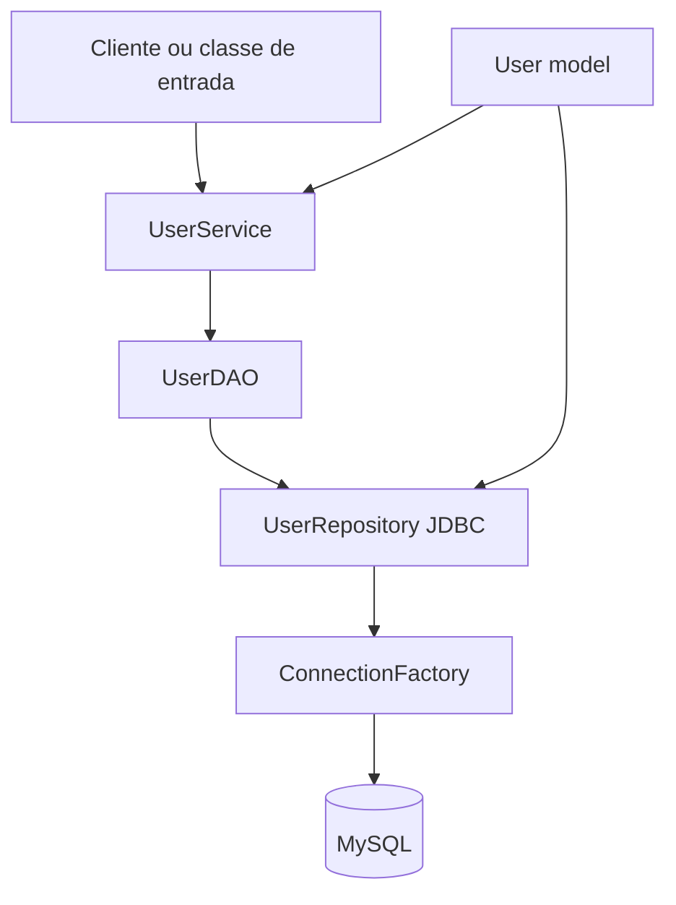

# User Management — Java + JDBC

Aplicação de estudo para cadastro e manutenção de usuários usando Java puro,
JDBC e o padrão DAO. O projeto demonstra a separação entre modelo, acesso a
dados e serviço de aplicação sem framework web.

## Problema resolvido

Implementar operações básicas de usuários — criar, listar, atualizar e remover
— mantendo o código de negócio desacoplado da conexão JDBC. A persistência é
feita em MySQL e a camada de serviço recebe uma abstração `UserDAO`.

## Arquitetura



- `model`: entidade/POJO `User`;
- `dao`: contrato de persistência;
- `repository`: SQL e implementação JDBC;
- `service`: operações de usuário;
- `factory`: criação de conexões;
- `test`: testes unitários do serviço com Mockito.

## Tecnologias

- Java 21;
- Maven;
- MySQL Connector/J 8.3.0;
- JUnit Jupiter 5.10;
- Mockito 5.5;
- AssertJ 3.24.

## Como executar

### Banco de dados

Crie o schema e a tabela:

```sql
CREATE DATABASE IF NOT EXISTS user_management;
USE user_management;

CREATE TABLE users (
    id INT AUTO_INCREMENT PRIMARY KEY,
    name VARCHAR(255) NOT NULL,
    email VARCHAR(255) UNIQUE NOT NULL,
    registration_date DATE NOT NULL
);
```

Configure `resources/db.properties` para o MySQL local. O arquivo atual contém
valores de exemplo; substitua a senha local e não grave credenciais reais.

### Build e testes

```bash
mvn test
```

O comando Maven termina com sucesso, mas o layout atual (`src/victor` e
`test/victor`) não segue os diretórios padrão `src/main/java` e `src/test/java`.
Assim, nesta configuração o Maven reporta `No tests to run`; os testes existentes
precisam ser reposicionados ou o `pom.xml` precisa declarar esses diretórios
explicitamente para serem executados.

## Decisões técnicas

- o serviço depende de `UserDAO`, facilitando testes unitários com Mockito;
- o repositório usa SQL/JDBC diretamente para fins didáticos;
- `LocalDate` representa a data de cadastro;
- MySQL é uma dependência de infraestrutura, não uma regra do serviço.

## Limitações

Não há API HTTP, autenticação, migrações, validação de entrada ou testes de
integração com banco. O projeto é um exercício de camadas e persistência JDBC,
não um serviço pronto para produção.
